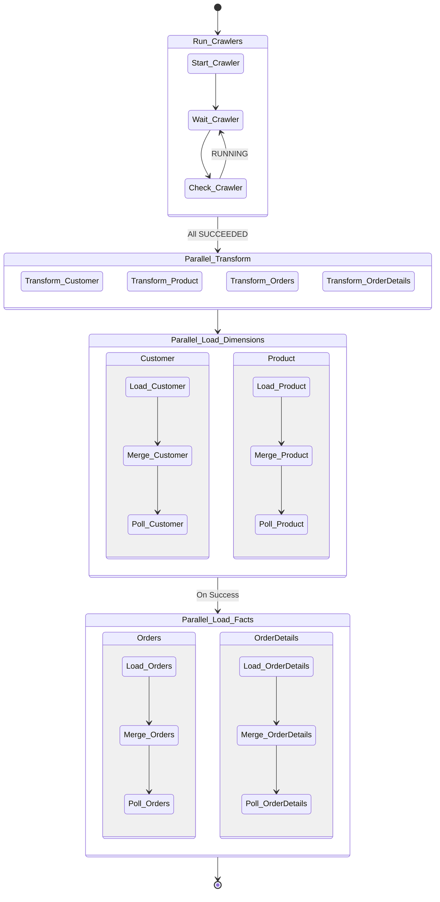

# Operations and Logic Guide

This document explains the functional logic and orchestration flow of the data pipeline for operators and maintainers.

## 1. Step Functions Orchestration

We use a sequential state machine to ensure data integrity and respect referential dependencies.

### 1.1. Crawl and Transform
Each execution first runs the four Glue Crawlers over the bronze layer, so new DMS files and columns are registered in the Data Catalog.
A crawler that is already running (for example, started by `make trigger-crawlers`) is awaited instead of failing the run.
The four transform jobs then convert bronze CSV into silver Parquet in parallel.
Job Bookmarks make each job process only the files it has not seen yet.

### 1.2. Parallel Dimensions
The state machine then processes the `Customer` and `Product` tables in parallel.
This is because these are **Dimension Tables** that contain the "Source of Truth" for attributes used by Fact tables.

### 1.3. Parallel Facts
Once dimensions are merged, the state machine loads `Orders` and `OrderDetails` into staging and merges them into `fact_orders` and `fact_order_details`.

### 1.4. Awaited Merges
Every stored procedure is started with the Redshift Data API `executeStatement` and polled with `describeStatement` every 10 seconds.
`FINISHED` ends the branch, while `FAILED` or `ABORTED` fails the whole execution with the procedure name and the Redshift error.
A succeeded execution therefore means the warehouse is up to date.
Each execution is capped at 2 hours, so a stuck poll loop cannot run forever.

## 2. Incremental Loading (SCD Type 2)

We implement **Slowly Changing Dimensions (SCD) Type 2** to maintain a full history of changes in the warehouse.

### 2.1. The Dimension Merge Sequence
The following sequence is executed within the dimension Stored Procedures (`sp_merge_dim_customer`, `sp_merge_dim_product`):

1.  **Stage**: Glue loads raw data into a `stage_` table.
2.  **Expire**: Existing records in the `Gold` table that have been updated in the `Stage` (detected by `hash_value` mismatch) are expired by setting `active_flag = 0` and `record_end_ts = current_ts`.
3.  **Insert**: New records (or new versions of updated records) are inserted into the `Gold` table with `active_flag = 1`.
4.  **Clean**: The `Stage` table is truncated.

### 2.2. The Fact Merge Sequence
Facts are not versioned, so the fact Stored Procedures (`sp_merge_fact_orders`, `sp_merge_fact_order_details`) upsert instead:

1.  **Stage**: Glue loads the new silver rows into `stage_fact_orders` / `stage_fact_order_details`.
2.  **Delete**: Fact rows whose ID appears in staging are deleted.
3.  **Insert**: The latest staged version of each ID (by `ingestion_date`) is inserted.
4.  **Clean**: The `Stage` table is truncated.

## 3. Glue Job State Management

To prevent duplicate data processing, we utilize two mechanisms:
- **Job Bookmarks**: Enabled on all Glue Spark jobs to track the last file processed in S3.
- **CDC Operations**: Our DMS task includes the `Op` column (I, U, D) which allows our Redshift procedures to distinguish between new inserts and updates.

## 4. Troubleshooting

- **SFN Failures**: Check the `Execution History` for the specific Glue job ID.
  A `RedshiftMergeFailed` error carries the Redshift error message, and `GlueCrawlerFailed` names the crawler.
- **Concurrency Errors**: We have set `max_concurrent_runs = 5` to allow the parallel branches of the state machine to run without contention.
- **Schema Errors**: If a Glue job fails with "Column not found," re-run the Glue Crawlers to refresh the Data Catalog with the latest DMS headers.
