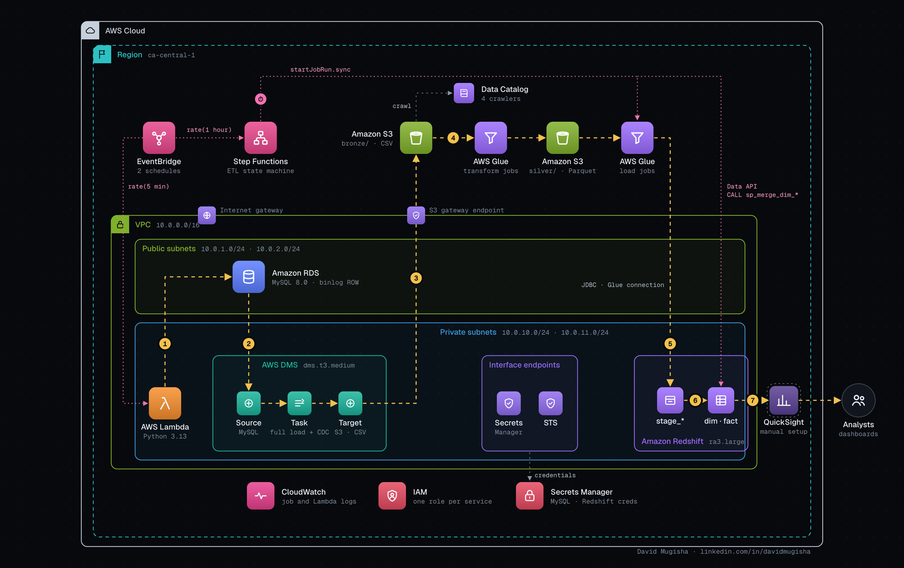

# Terraform Infrastructure Walkthrough

This guide explains how to deploy the AWS Data Engineering Project infrastructure using the provided Terraform code and the centralized `Makefile` control plane.

## What You Deploy



## Prerequisites
- **Terraform** installed (v1.0+).
- **AWS CLI** configured with appropriate credentials (`aws configure`).
- **Python 3.x** and **uv** (for Lambda and Glue job packaging).
- **Docker** (for local migrations and BI tools).

## Deployment Steps

1. **Initialize and Build**:
   Navigate to the project root and build the Lambda package:
   ```bash
   make build-lambda
   ```

2. **Provision Infrastructure**:
   Deploy the AWS resources via Terraform:
   ```bash
   cd terraform && terraform init && terraform apply -auto-approve
   ```

   > [!NOTE]
   > **Parallel Provisioning**: RDS, DMS, and Redshift are provisioned in parallel to reduce deployment time (approx. 15 minutes).

3. **Initialize RDS (Flyway & CDC)**:
   Navigate back to the project root and run migrations to setup the source schema:
   ```bash
   make setup-rds
   ```

4. **Initialize Redshift Warehouse**:
   Establish the Redshift `sales` schema, tables, SCD Type 2 procedures and fact merge procedures.
   Each statement is awaited in order, and the target stops on the first Redshift error:
   ```bash
   make setup-redshift
   ```

5. **Discover Schema (Glue Crawlers, optional)**:
   The Step Functions pipeline runs the crawlers itself on every execution.
   To refresh the Data Catalog by hand, for example before exploring it in Athena:
   ```bash
   make trigger-crawlers
   ```

6. **Trigger the Data Pipeline**:
   Start the end-to-end data flow:
   ```bash
   make trigger-dms      # Start CDC Replication
   make trigger-lambda   # Seed initial data
   make trigger-pipeline # Start Step Functions ETL
   ```

7. **Local Visualization (Optional)**:
   Spin up a local BI tool to explore the Redshift data:
   ```bash
   make run-metabase
   ```
   *Access at http://localhost:3000*

For a deep dive into the system's design, see the [Security Design](../SECURITY_DESIGN.md) and [Operations Guide](../OPERATIONS_GUIDE.md).

## Verification

1. **Check Infrastructure Outputs**:
   ```bash
   make tf-outputs
   ```

2. **Monitor Step Functions**: 
   Check the execution status in the AWS Console. The pipeline will:
   - Run the Glue Crawlers over the bronze layer.
   - Run Spark Jobs to transform bronze CSV to silver Parquet.
   - Load dimensions into Redshift Staging and run the SCD Type 2 merges.
   - Load facts into Redshift Staging and upsert them into `fact_orders` and `fact_order_details`.
   - Wait for every merge to finish, and fail the execution if one fails.

3. **Query the Warehouse**:
   Verify data existence via the Data API:
   ```bash
   aws redshift-data execute-statement \
     --cluster-identifier aws-de-project-dev-redshift \
     --database dev \
     --db-user adminuser \
     --sql "SELECT count(*) FROM sales.dim_customer;" \
     --region ca-central-1
   ```

## Resources Created
- **VPC**: Private network with S3, Secrets Manager, and Redshift endpoints.
- **S3**: Multi-layered Data Lake (Bronze/Silver/Scripts).
- **RDS**: MySQL source database with binary logging.
- **DMS**: CDC replication from RDS to S3.
- **Glue**: Serverless Crawlers and Spark ETL jobs.
- **Redshift**: RA3 cluster for data warehousing.
- **Step Functions**: Centralized ETL Orchestrator.

## Cleanup
To destroy all cloud resources:
```bash
cd terraform && terraform destroy -auto-approve
```
